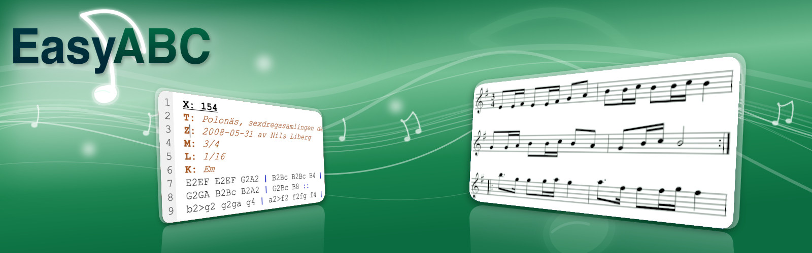
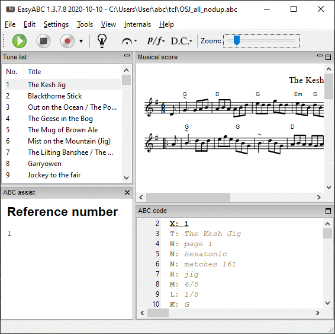
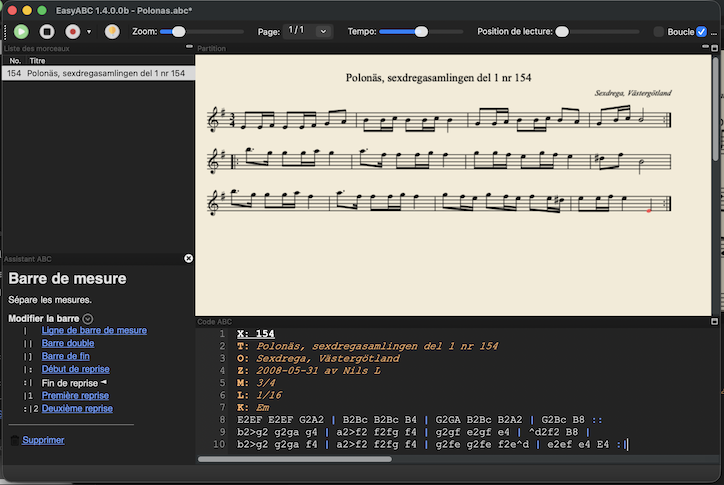
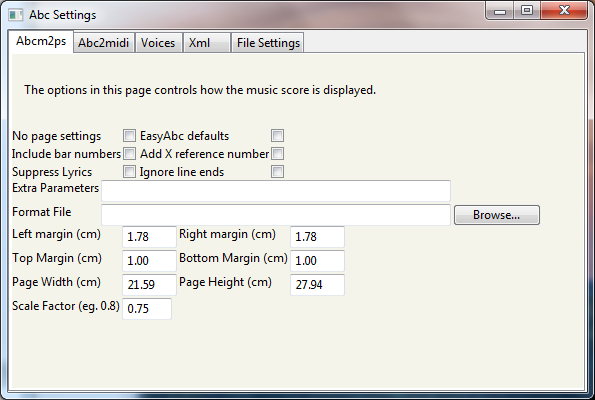
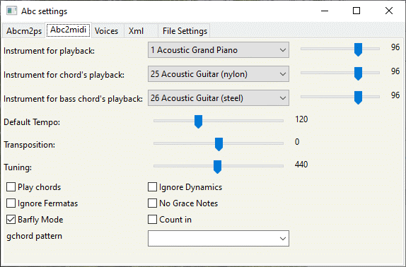
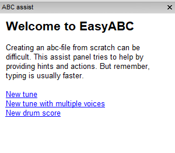
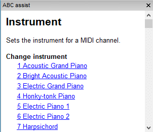
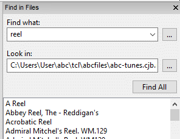

> **An open source ABC editor for Windows, macOS and Linux**
>
> [Source code (GitHub)](https://github.com/aupfred/EasyABC/tree/release-1.4.0) · [Downloads (SourceForge)](https://sourceforge.net/projects/easyabc/) · [Complementary guide](https://easyabc.sourceforge.io/)

---

## Introduction



EasyABC is an editor for [ABC music notation](https://abcnotation.com/), originally developed by Nils Liberg and maintained since 2015 by Jan Wybren de Jong, Seymour Shlien and Frédéric Aupépin. It combines a text editor with syntax highlighting, a real-time rendered musical score, and conversion tools to MIDI, MusicXML, SVG, PDF and HTML.

The main window is split into three or four resizable parts: the tune list, the musical score, the ABC code editor, and the *ABC assist* pane (toggled with the light bulb icon in the toolbar). Clicking a tune in the list displays its score and code; the play button plays the selected tune.

To get started, copy and paste this code into the ABC editor:

```abc
X: 1
T: My tune
K: C
CDEF | G2
```

The score is displayed at the top and an item called "My tune" appears in the tune list. With several tunes, single-click one to view it; double-click to play it (or use the play button in the toolbar).

## Installation

EasyABC relies on external programs installed in the `bin/` folder: **abcm2ps** (SVG rendering), **abc2midi** (MIDI generation), **abc2abc** (transposition), **Ghostscript** or `ps2pdf` (PDF export), **xml2abc / abc2xml** (MusicXML) and **midi2abc** (MIDI import).

- **Windows**: run the installer, then check the paths in *File ▸ Settings*.
- **macOS**: in packaged builds the executables live in the `Helpers` folder of the application bundle.
- **Linux**: EasyABC looks for executables in `/usr/local/bin` and `/usr/bin`, then falls back to `bin/` next to the program. Two options are available: a `.deb` package that installs all dependencies automatically (see below), or running from source (see [Running EasyABC from source](#sources)), which works on all platforms.
- **Ghostscript** (PDF export): download it from [ghostscript.com](https://www.ghostscript.com/) for Windows; for macOS, a prebuilt package is available on [Richard Koch's page](https://pages.uoregon.edu/koch/).

## Features

- Good ABC standard coverage thanks to abcm2ps and abc2midi.
- Syntax highlighting; the score is updated automatically as you type.
- Zoom support for the score and the editor.
- Import MusicXML, MIDI and Noteworthy Composer files (the MIDI-to-ABC translator is custom made and produces legible ABC code with more sensible beams than typical midi2abc output).
- Export to MIDI, SVG, PDF, HTML, MusicXML and WAV (single tune or whole tune book).
- Select notes by clicking on them and add music symbols via toolbar drop-down menus.
- Play the active tune as MIDI, with tempo and position sliders, looping and an optional metronome count-in.
- Record songs from MIDI directly in the program.
- Unicode (utf-8) and other encodings support.
- Transpose and halve/double note length functionality (using abc2abc).
- An abcm2ps format file can easily be specified in the settings.
- ABC fields in the file header are applied to every single tune in a tune book.
- Automatic alignment of bars on different lines.
- Available in Italian, French, Danish, Swedish, English and more.
- Functions to generate incipits, sort tunes and renumber X: fields.
- Musical search function — search for note sequences irrespectively of key, grace notes, L: field, broken rhythms, ornaments or slurs.
- Automatic removal of ties for simpler MIDI rendering.
- Support for MC Music Editor "sticky rhythm" (`L: mcm_default`).
- ABC assist for novice users; search-in-directory tool; progress bar for long batch operations.

## Entering and editing ABC code

A bar line in ABC is represented by the character `|`. As an alternative, simply hit the `Tab` key to insert one.

With a multi-tune file, the score display is updated and scrolled into position when you move the text cursor in the editor. Clicking with the mouse highlights the closest note in red. For performance reasons this does not happen with the arrow keys; press `Ctrl`+`L` (*Locate*) to highlight the closest note manually.

## Typing assistance
<!-- Screenshot to add: ABC assist panel while typing (abc-assist.png) -->

The *Settings ▸ ABC Typing Assistance* submenu enables automatic corrections:

- *Automatic uppercase/lowercase* — "C" and "c" correspond to different octaves. With this mode on, EasyABC picks the octave closest to the preceding note. Press `Shift` while typing to reverse the chosen case. Off by default.
- *Do-re-mi mode* — experimental sol-fa input with a movable do (e.g. "do" corresponds to a "D" if the key is D; the seventh degree is typed "ti"; one letter suffices, e.g. "r" for "re"). Can be combined with the previous mode. Off by default.
- *Add note durations* — on `Space`, EasyABC adds durations so the group adds up to a quarter note. With `L:1/8`: `AB` becomes `A2B2`, `ABC` becomes `A2BC`. Off by default.
- *Add bar* — when `Space` is pressed and the bar is full, a bar symbol is added automatically.
- *Add matching right symbol* — typing "(" adds the matching ")"; likewise for `[]`, `{}` and `""`.

## Editing shortcuts

When two or more notes are selected (in the ABC editor or in the score):

| Key | Effect |
| --- | --- |
| `(` or `s` | Adds (or removes) a slur around the selected notes |
| `.` | Toggles staccato on the selected notes |
| `<` / `>` | Introduces broken rhythm (can also cancel an existing one) |

The broken rhythm shortcut works on pairs of notes: "AB CD" + `>` becomes "A>B C>D". These functions may not work well with chords yet.

## Musical score



### Selecting notes

Click a note or rest in the score to select the corresponding ABC text — a direct link between the graphical and textual representation. Draw a rectangle to select a range of notes (hold `Ctrl`/`Cmd` to add to the existing selection). Clicking an empty white area deselects everything and moves the text cursor to the closest note — handy for inserting chords or annotations at the right place.

### Inserting musical symbols

Select the note you want to attach a symbol to, then pick the symbol from one of the toolbar drop-down menus (ornaments, dynamics, articulations, etc.).

### Zoom and pages

A toolbar slider controls the size of the score. Tunes that don't fit on a page are split into several pages, selectable from a drop-down menu; EasyABC auto-scrolls the score as you move through the ABC code but does not switch pages automatically. For very long tunes, you can turn off automatic score updates and refresh manually with `F5`.

## Playback and MIDI

- Play with the toolbar button or `F6` (`Shift`+`F6` on Mac).
- While playing, two extra sliders appear: tempo adjustment (`Ctrl`+click to reset) and playback position.
- Double-click the play button to loop the playback.
- Hold `Ctrl` while clicking play to audition without repeats.
- To play part of a tune, use the mouse to draw a rectangle over part of the score, highlighting the passage to play. The rectangle must encompass part of one line or several whole lines: it cannot start part-way through a line and end on another line.
- Once a passage is selected you can add another passage to the selection by holding `Ctrl` and drawing another rectangle: that way you can add together part-lines.
- In a multi-voice tune the selected passage can include one or more voices.
- MIDI settings cover instruments per voice, volume, panning, guitar chords (`%%MIDI gchord`), chord/bass accompaniment, default tempo, transposition and tuning (`-TT`).
- An optional metronome count-in can be added before the tune.
- MIDI recording: press *Rec*, play on your MIDI keyboard, then press *Stop*. The result is quantized (with triplet detection) and converted to ABC. On macOS, output goes through the system's MIDI synthesizer.

## Import / Export

To add an ABC, XML, NWC or MIDI file to the current collection, drag and drop it onto the EasyABC window, or use *File ▸ Import and add…*. The *File ▸ Export (all or selected)* menu saves the current tune or the whole book in several formats:

- **MIDI** — copies the file generated during playback from the cache to a location of your choice (cache files have random names, so exporting is the proper way to keep them).
- **PDF** — via Ghostscript or `ps2pdf` (see Installation).
- **HTML** — the score is embedded as SVG inside an HTML file, viewable in any browser without special software (browser add-ons can even print it). The **interactive HTML** variant embeds the ABC file and links it to Jef Moine's *abc2svg* JavaScript library: the tune is rendered in the browser and can be played while following the score — an internet connection is required.
- **MusicXML** — via abc2xml (Willem Vree's code, included in EasyABC), the standard format for exchanging digital sheet music, e.g. for MuseScore.
- **ABC** — unlike *File ▸ Save*, which saves the whole open file, this option exports only the selected tune.
- **WAV** — the tune is first converted to MIDI by abc2midi, then the MIDI file to a WAV audio file.

- `.nwc` files get specific post-processing: *Boxmarks* font text annotations are translated into ABC decorations (trills, bowings, etc.); in two-voice songs with repeat alternatives, bar symbols from the first voice are copied to the second so the generated MIDI is correct.
- ABC files are read as latin-1 by default; add a `%%abc-charset utf-8` line to use Unicode.

**Printing**: *File ▸ Print* prints the current tune. On Windows and macOS the quality may be limited (bitmap rendering); for high-quality print-outs, export to PDF first.

## Tools

### Aligning bars

*Edit ▸ Align bars* aligns all `|` characters in the current tune; select a subset of lines first to align only those. How it works: each line is split into measures and separators (the aligner distinguishes all bar symbols: `|`, `||`, `|:`, `:|`, `|1`, `::`, etc.); incomplete measures are padded with pseudo-elements, and bar separators are centered on the last `|` they contain. Detection of *anacrusis* (pickup measures shorter than 80% of a full measure, computed from the `M:` and `L:` fields, including triplets and broken rhythms) lets lines that start on an off-beat align correctly; the contents inside bars can be aligned too. The change can be undone.

### Transpose

The *Edit* menu offers transposition up/down and changing note lengths (adjusting the `L:` field), via abc2abc.

### Incipits

*Tools ▸ Generate incipits file...* produces an ABC file with an overview of how each tune starts (number of bars, repeats and titles, and sort fields are configurable); *View incipits* shows the final PDF using the default template.

### Sorting and renumbering

The *Tools* menu can sort the tunes in a file (multi-field sort key, e.g. "T,M") and renumber the X: fields.

### Search

If your search string begins with a colon, EasyABC enters a special *musical search* mode: it matches the intervals between notes, irrespectively of key. The mechanism: every note in the tune is converted to a number (C,, through b'' over 43 degrees), and the sequence of *intervals* between consecutive notes is encoded as characters; the search then runs over that interval sequence. Key, accidentals, grace notes (`{…}`), ornaments (`!…!` / `+…+`), annotations, comments, fields (`X:`, `T:`… including embedded `[I:…]`) and `%%begintext`/`%%beginps` blocks are ignored; so the search works even when the two versions use different `L:` fields, broken rhythms or slurs. For example `:gecc eceg` would find `d2>B2 G2G2 (BG)Bd`: the intervals between successive notes are the same in both cases. The search is performed tune by tune (split on `X:`) and does not work on chords.

## Internals
<!-- Screenshot to add: Messages / Input Processed Tune pane (internals.png) -->

EasyABC acts as a graphical front end to command-driven programs such as abcm2ps and abc2midi, which are updated independently — you should point EasyABC at their latest versions. Errors and warnings no longer appear in pop-up windows: a short note in the status bar indicates whether the program ran normally, and the *Internals* menu lets you investigate.

### Messages

Shows the communication between EasyABC and the external programs: the full command line (e.g. `abcm2ps - -O temp-…-.svg -v -A`) and the program output. For instance `stdin:18:15: warning: Line underfull` means a music line was not completely filled — usually harmless. The window refreshes on every operation (playback, tune selection…). Temporary SVG and MIDI files in the cache folder get long random names to avoid collisions, especially when several EasyABC instances run side by side.

### Input Processed Tune

Shows the data actually submitted to the external program, with numbered lines so you can relate warnings to the input. The processed tune contains extra lines added by EasyABC: page margins for abcm2ps (`%%leftmargin 0.5cm` etc.) or `%%MIDI` commands for abc2midi (instrument, volume, pan, chords…). You can copy the contents with `Ctrl`+`A` / `Ctrl`+`C`.

### MIDI Disassembled

Displays the MIDI file in text form (via `midi2abc -mftext`). An advanced feature useful for diagnosing playback problems: each line lists the time in beats, the command, the MIDI channel (1–16), the pitch and the velocity. Simple files produce a single-track MIDI; files with voices or guitar chords produce multiple tracks (one per voice, plus bass/chords).

### Show settings status

Displays the readable contents of `settings1.4.dat`, the file where EasyABC stores its configuration. If EasyABC becomes inoperable, *Settings ▸ Cold Restart* resets all options to factory settings.

Temporary files (SVG, MIDI) and `settings1.4.dat` live in a hidden folder: `AppData/Local/EasyABC` on Windows, a dot-prefixed folder (e.g. `.EasyABC`) on Linux. The *Settings ▸ Clear Cache…* menu item shows the cache location without deleting it. If EasyABC fails to start, delete `settings1.4.dat` or use the cold restart: a default settings file will be recreated.

## ABC Settings





The *File ▸ ABC Settings* dialog is a tabbed notebook. Hovering the mouse over most controls shows helpful tooltips. Settings are remembered in `settings1.4.dat`.

### File Settings

- Paths to the executables (abcm2ps, abc2midi, abc2abc, midi2abc, Ghostscript…), verified at each startup. Paths are stored in combo boxes so you can switch between versions conveniently.
- Windows: `gswin32c.exe` or `gswin64c.exe` for PDF; macOS: `pstopdf` or Ghostscript; Linux: `gs`.
- An external MIDI player can be specified (e.g. TiMidity on Linux, with its options in "Extra Midiplayer Parameters", e.g. `-ik -A 50`).
- The *restore settings* button resets the paths you have cleared.

### Abcm2ps Settings

- *EasyABC defaults*: guaranteed familiar rendering. *No page settings*: EasyABC adds no commands if your tune embeds its own abcm2ps layout. To customize, uncheck both boxes: margins, page width/height and scale entry boxes appear (values in cm, without units).
- Include bar numbers (useful for interpreting abc2midi warnings — note abc2midi counts bars from zero), add the X reference number to the title, suppress lyrics, ignore line ends (`%%continueall`).
- *Extra Parameters*: any abcm2ps command-line option (e.g. `-i` to locate errors). Verify them via *Internals ▸ Messages*.
- A format file (`.fmt`, e.g. the Turkish makam `commaA-E.fmt` for microtones) can be specified; abcm2ps will not find `%%format` files referenced inside a tune without a full path.

### Abc2midi Settings

- Default tempo (abc2midi assumes 120 bpm when no `Q:` is given), default instrument (Acoustic Piano), melody volume and pan.
- Guitar chords: on/off, separate instruments and volumes for the bass and the chords (two distinct MIDI channels), customizable `gchord` pattern (default pattern follows the time signature).
- Transposition (e.g. for a B♭ clarinet) and tuning up to one semitone either way (`-TT`).
- Check boxes: ignore dynamics (`-NFNP`), ignore grace notes (`-NGRA`), ignore fermatas (`-NFER`), Barfly stress model (`-BF`, applied when the tune has a recognized `R:` rhythm designator).
- *Count in*: prefixes the tune with two bars of metronome clicks adapted to the time signature, so you can get your instrument ready to play along.
- If the tune already contains `%%MIDI` commands, EasyABC suppresses its own of the same type — edit the ABC code directly to change them.

### Voice Settings

For tunes containing `V:` voice indications. Instruments are specified per voice (16 MIDI channels; channel 10 is usually reserved for percussion). On Mac, control codes are prefixed to work around QuickTime quirks. Voice overlays (the ampersand `&`) are supported but can be less than intuitive. The "separate defaults per voice" option defines instrument, volume and pan for each of the 16 channels; EasyABC assigns the selected program to a voice the first time it appears in the notation.

### XML Settings

MusicXML ⇄ ABC conversion options (xml2abc / abc2xml), considered experimental. The free program MuseScore is a good companion for displaying, playing and creating MusicXML files and importing MIDI files.

## ABC assist





ABC assist is useful for both beginners and experienced users. Toggle it with the light bulb icon in the toolbar: the pane appears at the bottom left (it can be docked or floating, and follows dark mode). It is *contextual*: it analyzes the cursor position (file header, tune header, tune body, empty line…) and shows the description of the ABC element under the cursor (field, directive, note, bar…) together with the applicable actions — all as clickable links. The documentation shown comes from the ABC standard reference and, for directives, from the online abcm2ps and abc2midi documentation.

### Starting a tune

On an empty file, click *New tune*: ABC assist generates a complete skeleton (`%abc-2.1` header, `X:`, `T:`, `C:`, `M:`, `L:`, `Q:`, `K:C`, with the X: number following the last one used). Three templates are available:

- **Simple tune** — one voice in C major, 4/4;
- **Multi-voice tune** — four SATB voices with clefs, `%%score [ (S A) (T B) ]` layout and per-voice MIDI instruments;
- **Drum score** — two percussion-clef voices, with `%%MIDI drummap` (channel 10) and ready-to-listen drum patterns.

You can also *add a voice* to an existing tune (next `V:`, treble clef), and add/remove staves from a `%%score`/`%%staves` directive.

### Entering notes and editing assistance

On an empty line in the tune body, the pane offers to insert a **note or rest** (C…b, z); bar lines `|` are inserted automatically when the measure is full. *New line* and *Space* buttons exist for mouse-only users. On an existing note, the pane offers:

- **Pitch**: note up/down, third up/down, octave up/down; **accidental** (flat, natural, sharp, doubles and quarter tones); "simplify note" to rewrite the octave in canonical form;
- **Duration**: default, halve, double, dotted, broken rhythm (`>`/`<`), tie (`-`); for rests: visibility (`z` vs `x`), whole-measure rest (`Z`/`X`) and measure count;
- **Grouping**: slur (normal or dashed), **triplet** on three selected notes, **beam** to put multiple eighth notes under one beam, conversion to a **chord** [`[CEG]`]; grace notes (appoggiatura/acciaccatura);
- **Decorations**: dynamics (pppp→ffff, sfz, crescendo/diminuendo), ornaments (trill, mordent, roll, turn, arpeggio), articulations (staccato, accent, marcato, tenuto, bowings, pedal…), fingering (0–5), direction markers (segno, coda, D.C., D.S., fine) — with images and redefinable symbols (`U:`);
- **Annotations and chord symbols**: insertion, position (above/below/left/right), annotation ⇄ chord conversion; for chords, chord suggestions *relative to the tune's key* and editing of the name (m, 7, M7, dim, sus, 9…) and bass note (`/G`);
- **Bars and variant endings**: single, double, final bar, repeat points, first/second ending, invisible bar, voice overlay (`&`).

### Header and fields

In the tune header, the pane lets you change the **key signature** (number of sharps/flats or `none`) and **mode** (major, minor, dorian, phrygian, lydian, mixolydian, locrian) without changing the displayed tonic, the **clef** (treble, bass, C-clefs, perc… with octave and ±8va transposition), the **meter** (C, C|, 2/4…12/8), the **unit note length** `L:`, the **tempo** (name — Allegro, Presto… — and/or metronome, with the referenced note length), octave and playback transposition, and field visibility (`%%writefields`). Measure numbering (`%%measurenb`/`%%barnumbers`) can be controlled too.

### MIDI directives

On a `%%MIDI` directive, the pane offers:

- **Instrument** (`%%MIDI program`): the complete list of the 128 General MIDI instruments, with optional channel;
- **Channel** (1–16); **volume** (`control 7`, `chordvol`, `bassvol`) shown as a percentage with a visual gauge;
- **Percussion**: `%%MIDI drummap` and `%%percmap` with the full General MIDI 2 percussion instrument list (snare, hi-hat, toms, cymbals…);
- **Guitar chords** (`%%MIDI gchord`): preset patterns adapted to the meter (even or odd), a pattern editor (f = fundamental, c = chord, z = rest, 2 = double duration, G/H/I/J = chord notes…) and time adjustment.

On `%%score`/`%%staves`: show a single voice, add/remove displayed voices, group on the same stave (parentheses), brace or bracket together, and toggle continued bar lines between staves.

Finally, the pane detects **invalid characters** and offers to replace them, shows the description of each abcm2ps directive with a "learn more" link to the online documentation, and hides rare options behind a "more options" arrow to limit scrolling.

## Sound output
<!-- Screenshot to add: FluidSynth sound output settings (sound-output.png) -->

EasyABC relies on MIDI synthesizers to produce audio. Native MIDI support has become rarer on modern systems (Windows Media Player no longer ships with Windows 10 by default), so playback sometimes needs manual setup:

- **Windows**: playback usually works seamlessly; score following works both forward and reverse.
- **macOS**: output goes through the system MIDI synthesizer (QuickTime / mplay).
- **FluidSynth**: when the `fluidsynthplayer` library is available, EasyABC plays the tune using a SoundFont (`.sf2`) specified in the settings — much more realistic timbres than the default GM synthesizer. Note that players such as TiMidity and FluidSynth do not come with soundfonts: you must install a `.sf2` and point EasyABC at it (e.g. `/usr/share/sounds/sf2/FluidR3_GM.sf2` on Linux).
- **Linux**: if playback produces no sound, the easy way out is to specify **fluidsynth** as your MIDI player; the proper solution goes through **JACK**: start `jackd` and add `--audio-driver=jack --connect-jack-outputs` to the MIDI player parameters.
- As a last resort, an **external MIDI player** can be specified in *File ▸ Settings ▸ File Settings* — but score following no longer works.

## Find in files



This function, found under the Edit menu, searches a large collection of ABC files for words in titles, composers, lyrics, etc. For example, to find all tunes by Bach in the key of G and 9/4 meter:

```
C:bach M:9/4 K:G
```

On first use, specify the top-level folder where your ABC files live (subfolders included); the tool remembers it for future searches. Clicking a result loads the ABC file into EasyABC, positioned at the selected tune. The exhaustive search can take a while, but you can stop it anytime via the progress bar.

## Interface

- Each pane ("Tune list", "ABC code", "Musical score") can be moved by dragging its title bar; the buttons on the right of the caption minimize/maximize/restore the pane.
- *View ▸ Restore default layout* resets the arrangement.
- Editor font size: `Ctrl`+`+` / `Ctrl`+`−`, or *View ▸ Change font*.
- The *Messages* window shows the output of the external programs (abcm2ps, abc2midi…), useful for diagnosing ABC syntax errors.

## Running EasyABC from source

This procedure is common to Windows, macOS, Linux and the Raspberry Pi; on Linux and the Raspberry Pi it is the recommended way to run EasyABC. First get the code from the [release-1.4.0](https://github.com/aupfred/EasyABC/tree/release-1.4.0) branch of the GitHub repository (*Code ▸ Download ZIP* button, or `git clone -b release-1.4.0`).

### With a Python virtual environment (recommended)

1. Install **Python 3.10 or later** (the versions tested primarily are 3.12 and 3.13): on Windows and macOS, download it from [python.org/downloads](https://www.python.org/downloads/); on Linux, use the `python3` package of your distribution.
2. Create a virtual environment and install the dependencies listed in `requirements.txt`:

```
python -m venv venv          # python.exe -m venv venv on Windows
pip install --upgrade pip
pip install -r requirements.txt
```

The virtual environment is illustrated here with `venv`, but other solutions (`uv`, `virtualenv`, `conda`…) work the same way. `requirements.txt` covers in particular **wxPython 4.2.x** (the GUI framework), **pyparsing** and, for macOS packaging, **py2app**. On Windows also run `py -m pip install pywin32 pygame` if needed. Then run `python3 easy_abc.py` (or double-click `easy_abc.py` on Windows); if it crashes, start it from a command window to read the error messages.

### With distribution packages (Debian and derivatives)

On Debian-style distributions (Debian, Ubuntu, Mint…) the dependencies can also be installed as system packages instead of using a virtual environment:

```
sudo apt install python3-wxgtk4.0 python3-pyparsing python3-six \
  python3-pygame fluidsynth abcm2ps abcmidi fluid-soundfont-gm
```

Then run `python3 easy_abc.py` directly. Be aware however that the Debian/Ubuntu repositories currently ship wxPython 4.2.0, which can raise a "Bad perspective string" error at startup; that bug is fixed from wxPython 4.2.3 onwards (see [issue jwdj/EasyABC #126](https://github.com/jwdj/EasyABC/issues/126), which also details installation on openSUSE, Debian, Ubuntu and Mint). The virtual environment, which installs wxPython through `pip`, therefore remains the safest option.

**Raspberry Pi**: EasyABC runs on the Raspberry Pi 4 (thanks to John Lowry for the report): install `abcmidi abcm2ps fluid-soundfont-gm python3-wxgtk4.0` and, if needed, build FluidSynth (`cmake`, `make libfluidsynth`) then copy `libfluidsynth.so*` next to `easy_abc.py`. The default soundfont is `/usr/share/sounds/sf2/FluidR3_GM.sf2`. Note: printing does not work properly on the Pi — export a PDF and print it with another program.

## Release history

A summary of the changes since version 1.3.5 — the complete log is available in the repository's change log.

### 1.3.5.P6 – P9 (patch fixes)

- Compatibility with recent abcm2ps versions (`in`/`px` suffixes on SVG width/height) — patch by Frédéric Aupépin.
- Fixed dim staff lines, bar lines and note stems on Linux.
- Separate instruments for chord, bass and each voice; new per-voice `%%MIDI` settings.
- More reliable playback looping (MEDIA_FINISHED/STOP events).
- F7 stops the MIDI player; arrow keys now move the highlighted note in sync; updated Italian translation.

### 1.3.6 – 1.3.6.4 (2015)

- Major rework: the *Internals* menu, tabbed settings notebook.
- Permanent caching removed: temporary files (temp.abc, temp001.svg, …) are now overwritten as the program runs.
- New tool for searching tunes in a folder and its subfolders.
- Cold Restart.
- Much faster SVG rendering (J.W. de Jong); unique MIDI/SVG file names across instances.
- Default loudness raised from 64 to 96; bar numbering; optional two-bar count-in.

### 1.3.7.x (2016–2019)

- ABC Assist: dockable/floating window, triplets, slurs, chords, microtones, multivoice/drum templates, MIDI instrument and volume selection.
- Page navigation shortcuts: `Ctrl`+`Alt`+`PgDn/PgUp`, `Home`/`End`.
- Python 3 compatibility (2 and 3 simultaneously from 1.3.7.4 on).
- "Follow score" while playing, with checkbox and timing compensation slider.
- Multi-tune selection for printing and export (ABC, single PDF); Dutch and German translations.

### 1.3.8.x (2020–2021)

- Find in files (`Ctrl`+`Shift`+`F`) with ABC fields (e.g. `C:mozart M:3/4`); exclusive mode via the command line (`-exclusive`).
- Python 2 definitively dropped; Windows installer moved to Python 3.
- WAV export via FluidSynth; "HTML interactive" export via Jef Moine's abc2svg.
- Tablet mode: full screen (`Shift`+`Alt`+`F`), navigation by clickable screen zones.
- Instant startup sound (small SoundFont then switch on first play); FluidSynth 2.x, pulseaudio driver by default.
- Chinese translation; "Insert musical symbol" menu removed then restored.

### 1.4.0.0

- New exports: **MP3** and **AAC** (via the ffmpeg setting); distinct colors for selection and follow; user-defined editor colors.
- New: **dark mode** support (including toolbar icons), "internal list of tunes" menu.
- MIDI playback on Mac via Apple's DLS synthesizer (the *mplay* library).
- Improvements: note highlighting following the editor cursor, multivoice graphical selection, respect of `%%abc-charset`, window title marking unsaved changes.
- Updated xml2abc/abc2xml and adaptation to newer abcMIDI and Python versions; many playback, display and copy/paste fixes.

## Credits — software components used by EasyABC

- [abcm2ps](http://moinejf.free.fr/) — ABC to score images (Jean-François Moine)
- [abc2midi](https://abc.sourceforge.net/abcMIDI/) — ABC to MIDI (James Allwright, maintained by Seymour Shlien)
- [xml2abc](http://wim.vree.org/svgParse/xml2abc.html) / [abc2xml](http://wim.vree.org/svgParse/abc2xml.html) — MusicXML ⇄ ABC (Willem Vree)
- nwc2xml — Noteworthy Composer to ABC via XML (James Lee)
- [wxPython](https://www.wxpython.org/) — cross-platform UI framework
- [Scintilla](https://www.scintilla.org/) — the text editor used for ABC code
- [PortMIDI](https://sourceforge.net/apps/trac/portmedia/wiki/portmidi) / pygame — real-time MIDI input
- FluidG3 GM Soundfont from Frank Wen embedded in the Windows setup
- Thanks to all the project's translators and contributors.

EasyABC is published under the [GPL v2 license](https://www.gnu.org/licenses/). Bug reports and source code:  [jwdj/EasyABC](https://github.com/jwdj/EasyABC) repository. Also available here with tags and releases: [GitHub (aupfred/EasyABC, release-1.4.0 branch)](https://github.com/aupfred/EasyABC/tree/release-1.4.0) Frozen versions are also downloadable from [SourceForge](https://sourceforge.net/projects/easyabc/), which also hosts a [complementary guide](https://easyabc.sourceforge.io/).
## Keyboard shortcuts

- <kbd>F5</kbd> Refresh
- <kbd>F6</kbd> Play current song
- <kbd>F7</kbd> Stop song
- <kbd>Ctrl-Shift-F</kbd> Find in Files (or show entire collection)
